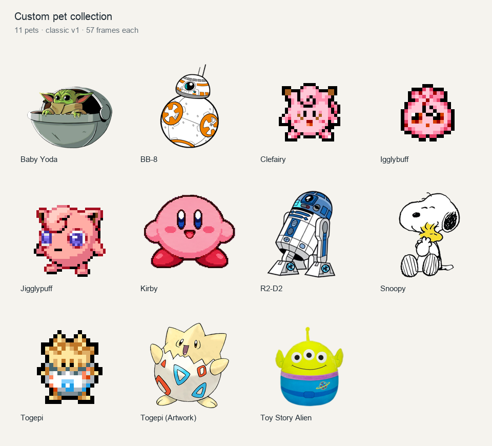

# Custom pets

My Codex Pet collection based on my favorite characters that make vibecoding a little bit more fun

## Download

1. Open [pets](pets) and choose a character's folder.
2. Open `spritesheet.png` and select **Download raw file**.
3. Download `pet.json` too if you will use the Pets plugin.

To download all pets, select **Code > Download ZIP** on the repository page and extract it.

## Use in ChatGPT Work

1. Open **Settings > Personalization > Pet > Select pet**.
2. Select **Upload pet** and upload `spritesheet.png`.
3. Select your new pet.

Requires Pets access in your account. [Official instructions](https://learn.chatgpt.com/docs/pets).

## Use with the Pets plugin

1. Open a chat with the Pets plugin enabled.
2. Attach `spritesheet.png` and `pet.json`.
3. Send this prompt:

   > Import this sprite sheet as a custom pet. Use the name and description from pet.json. Keep the original image and classic v1 format, then select the new pet.

[Artwork credits](CREDITS.md)
